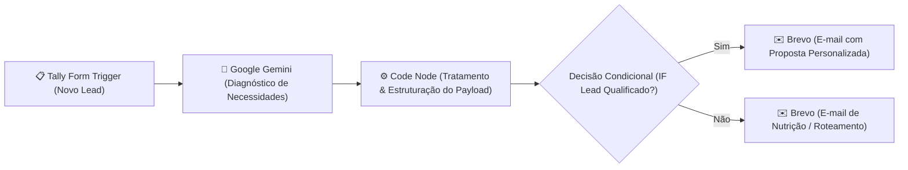

# 💼 LeadPulse AI — Autonomous Commercial Lead Triage & Proposal Engine

  
  
  
  

Agente autônomo de qualificação comercial e envio de propostas para consultorias e empresas de serviços. Integra formulários de entrada (**Tally**), raciocínio analítico com **Google Gemini**, sanitização programática de dados e disparo de e-mails transacionais customizados (**Brevo/Sendinblue**).

---

## 💡 O Problema de Negócio

Em vendas B2B e consultorias, o tempo de resposta (*Speed to Lead*) é o fator decisivo para a conversão: responder em até 5 minutos aumenta em até 8x as chances de fechar negócio. Triagens manuais costumam demorar horas ou dias, esfriando o lead.

---

## ⚡ A Solução Implementada

---

## 🎯 ROI & Impacto Operacional

* **Speed to Lead:** Redução de 24h para **menos de 30 segundos** entre o preenchimento do formulário e a entrega da proposta na caixa de entrada do cliente.
* **Personalização em Escala:** Cada proposta contém argumentos e diagnósticos gerados sob medida pelo Gemini com base nas dores relatadas no formulário.
* **Economia de Recursos:** Libera a equipe de vendas para focar apenas nas reuniões de fechamento, eliminando a redação manual de propostas padrão.

---

## 📂 Arquivos do Repositório

* `workflow.json`: Exportação oficial do fluxo pronta para importação no n8n.
* `README.md`: Documentação executiva de produto e arquitetura.

---

## 🚀 Como Usar no n8n

1. Baixe o arquivo `workflow.json`.
2. No seu n8n, crie um novo workflow e clique em **Import from File**.
3. Configure suas credenciais:
   * **Tally:** Conecte o Webhook do seu formulário no nó `Tally Trigger`.
   * **Google Gemini:** Insira sua API Key no nó de IA.
   * **Brevo:** Configure sua chave de API para disparo transacional.
4. Ative o workflow.

---

## 👨‍💻 Autor

Desenvolvido por **[Cauã Ribeiro](https://github.com/CauaRibeiroXY)**  
*Acadêmico de Ciência da Computação (IFNMG) • AI Builder & Engenheiro de Software*
